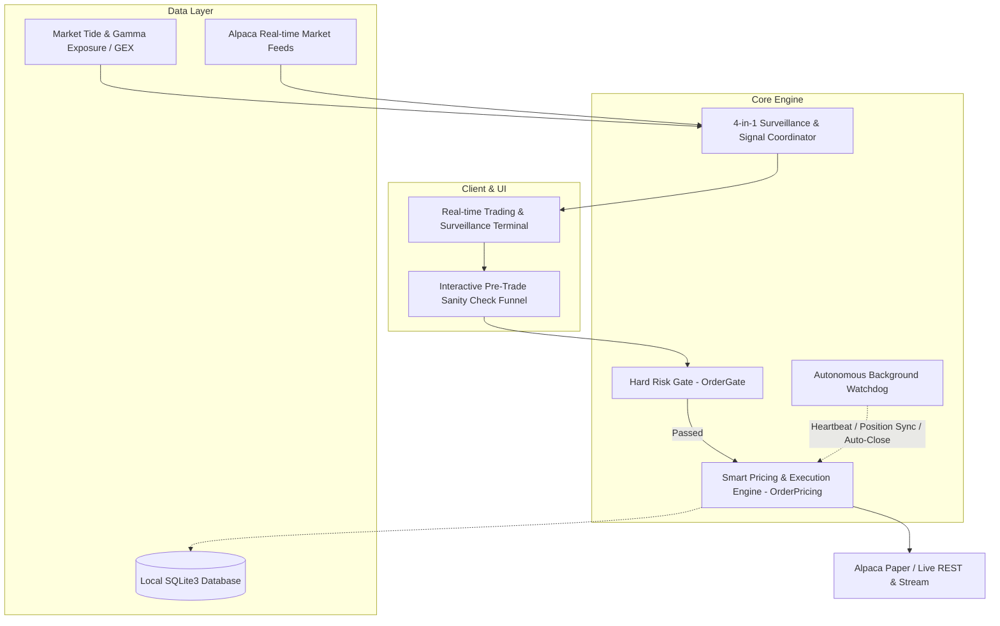
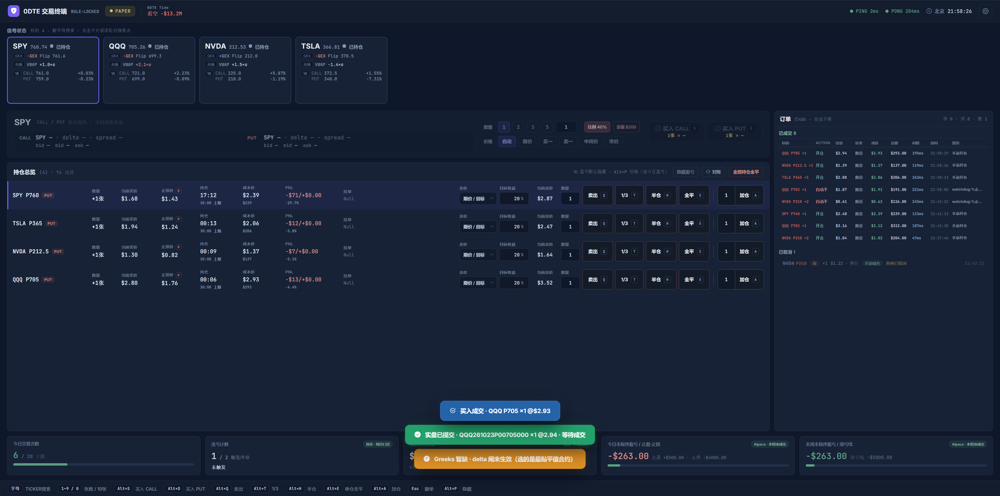
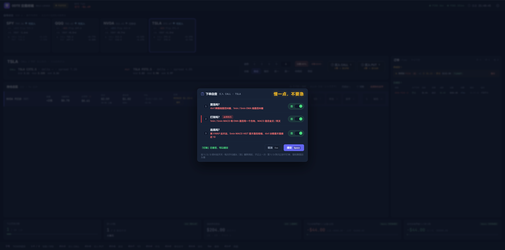
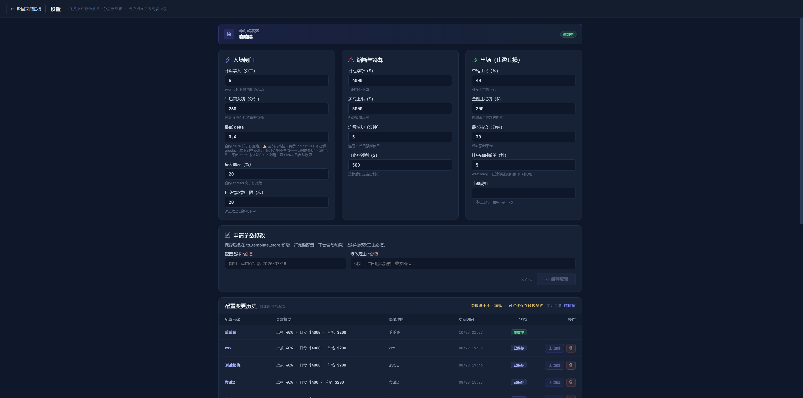

# alpaca-0DTE

> **A High-Performance, Rule-Locked 0DTE Options Quantitative Trading & Real-Time Risk Execution Engine for Alpaca.**

[](https://www.python.org/)
[]()
[](LICENSE)
[](https://github.com/psf/black)


---

## ⚠️ High-Risk Financial & Legal Disclaimer

> **PLEASE READ CAREFULLY BEFORE USING THIS SOFTWARE:**
> 1. **Extreme Risk of Total Capital Loss**: Zero Days to Expiration (0DTE) options are highly speculative derivative instruments characterized by exponential time decay (Theta) and extreme leverage. Small adverse movements in the underlying asset can cause contracts to lose 100% of their value in minutes.
> 2. **Research & Educational Purposes Only**: This codebase, including all documentation, execution algorithms, and risk gates, is published solely for quantitative software engineering, system architecture, and algorithmic trading research. **It does not constitute financial, investment, legal, or tax advice.**
> 3. **No Warranty & Limitation of Liability**: This software is provided **"AS IS" WITHOUT WARRANTY OF ANY KIND**, express or implied, including but not limited to fitness for a particular purpose or non-infringement. Under no circumstances shall the authors, maintainers, or contributors be held liable for any direct, indirect, incidental, or consequential financial losses arising from software defects, broker API outages, network latency, slippage, or execution decisions. **Live trading is conducted entirely at your own risk.**

---

## Overview

**alpaca-0DTE** is an institutional-grade, single-process asynchronous trading execution engine tailored specifically for intraday 0DTE options. Built on top of **FastAPI**, **WebSockets**, and the **Alpaca Broker API**, the system bridges the gap between high-speed market analytics and rigorous psychological trade execution.

By combining real-time order-flow intelligence (GEX Gamma Walls and Market Tide) with automated pre-trade risk gates and background self-healing watchdogs, alpaca-0DTE enforces ironclad risk rules before, during, and after order entry.



---

## 🖥️ Terminal Showcase

### Real-Time Trading & Surveillance Terminal

*Live 0DTE options execution terminal featuring real-time GEX Gamma Walls, 0DTE Market Tide sentiment, 4-in-1 multi-ticker surveillance, dynamic limit pricing, and active ladder exit controls.*

<br>

| 🛡️ Pre-Trade Sanity Check Funnel | ⚙️ Risk Gate & Strategy Configuration |
| :---: | :---: |
|  |  |
| *Keyboard-driven modal forcing emotional reset, trend confirmation, and setup verification before order dispatch.* | *Rule-locked risk parameters: opening blackout windows, daily/weekly loss circuit breakers, and trailing exit rules.* |

---

## Key Features

### 1. Millisecond 4-in-1 Market Surveillance
* **Gamma Exposure (GEX)**: Real-time tracking of zero-gamma flip points, major Put/Call walls, and magnetic price levels.
* **0DTE Market Tide**: Live aggregation of institutional block orders, aggressive delta premium flow, and dark pool sweeps.
* **Dynamic Universe Rotation**: Automatic filtering of index and equity 0DTE candidates meeting strict liquidity, volume, and bid-ask spread criteria.

### 2. Rule-Locked Pre-Trade Hard Gates (`OrderGate`)
Mechanically block impulse, revenge, and FOMO entries before any order reaches the broker:
* **Circuit Breaker**: Hard shutoff upon hitting maximum daily or weekly loss limits.
* **Loss Cooldown**: Mandatory lockout timer triggered after two consecutive losses to enforce psychological reset.
* **Opening Blackout**: Strict restriction on new entries during volatile opening minutes and late-afternoon liquidity decay.
* **Contract Validation**: Filters out excessively wide bid-ask spreads and unviable Out-of-the-Money (OTM) deltas.

### 3. Self-Healing Execution Watchdog (`Watchdog`)
* **Orphan & Resting Order Cleanup**: Automatically cancels stale resting orders past the execution timeout window.
* **Asynchronous SL/TP Monitor**: Background coroutines decouple stop-loss and take-profit enforcement from the main websocket stream, guaranteeing timely closing orders.
* **Broker Reconciliation**: Continuous position and order synchronization detects broker-side discrepancies and phantom fills.
* **Resilient Connectivity**: Millisecond-level auto-reconnect and state recovery for market data and trading streams.

### 4. Interactive Pre-Trade Sanity Funnel
A keyboard-driven modal prompts the trader to verify market structure (range-bound, breakout, or trend confluence) before execution, recording deliberate decision tags to local SQLite database for post-session trade analysis.

---

## Supported Data Sources & Fallback Architecture

| Data Provider | Purpose | Required? | Features Enabled |
| :--- | :--- | :--- | :--- |
| **Alpaca API** | Primary Broker & Market Data | **Mandatory** | Account sync, 0DTE Option quotes, BBO, Order execution, Bracket SL/TP |
| **Unusual Whales (UW)** | Options Flow & Gamma Intelligence | *Optional* | Spot GEX, Gamma Walls, 0DTE Market Tide net flow badge, News headlines |
| **Massive.com** | Historical Reference & Options Chain | *Optional* | Alternative option chain lookup and secondary verification |
| **Local Mock Replay** | Deterministic Offline Backtesting | *Optional* | Full session playback without internet or broker dependencies |

### ⚠️ What Happens If Unusual Whales (UW) Is Not Configured?

**The core trading and execution engine remains 100% operational.**

The system is designed with a **graceful degradation architecture**:
* **Zero Disruption to Execution**: All core algorithmic trading, position sizing, hard risk gates (`OrderGate` circuit breakers, daily drawdown limits, consecutive loss lockouts, opening blackout windows), and background watchdog reconciliations run exclusively on Alpaca's primary feed.
* **Non-Blocking Fallback**:
  - The top-bar **Market Tide Badge** remains in a neutral/idle state and will not calculate net delta premium flow curves.
  - The **GEX Wall Proximity Alert** (warning when the underlying price nears a major Put/Call gamma wall) is automatically bypassed.
  - The breaking news ticker remains blank.
* **Fail-Safe Guarantee**: The engine will **never** reject an order, freeze, or halt execution due to an unconfigured or invalid UW API key.

---

## Project Structure

```text
alpaca-0DTE/
├── app/                      # Application source code
│   ├── main.py               # Application entrypoint & lifespan management
│   ├── config.py             # Configuration loader & proxy management
│   ├── order_exec.py         # Order lifecycle, submission & state recovery
│   ├── order_gate.py         # Pre-trade hard risk gatekeeper (OrderGate)
│   ├── order_pricing.py      # Dynamic limit pricing & aggressive fill logic
│   ├── watchdog.py           # Background integrity watchdog & position guardian
│   ├── datasource/           # Data provider routing and abstractions
│   ├── integrations/         # Alpaca, Unusual Whales, and broker API clients
│   ├── services/             # GEX, Market Tide, and candidate selection services
│   ├── watcher/              # Multi-ticker surveillance coordinator
│   └── routers/              # FastAPI REST endpoints & WebSocket streams
├── static/                   # Real-time web UI, charts, and trading terminal
├── tests/                    # 1,400+ automated unit & integration test suites
├── scripts/                  # Network benchmarks and database migration schemas
├── .env.example              # Environment variables template
├── requirements.txt          # Production dependencies
├── requirements-dev.txt      # Development & test dependencies
└── pyproject.toml            # Project build & test configuration
```

---

## Quick Start

### 1. Prerequisites
* Python 3.12 or higher
* Alpaca Trading Account ([Paper Trading](https://alpaca.markets/) credentials recommended for initial setup)
* Git

### 2. Installation

Clone the repository and prepare a virtual environment:

```bash
git clone https://github.com/your-username/alpaca-0DTE.git
cd alpaca-0DTE

# Create and activate virtual environment
python -m venv .venv

# On Linux / macOS:
source .venv/bin/activate

# On Windows (PowerShell):
.venv\Scripts\Activate.ps1
```

Install the dependencies:

```bash
pip install -r requirements.txt
pip install -r requirements-dev.txt
```

### 3. Configuration

Generate your environment file from the template:

```bash
cp .env.example .env
```

Open `.env` and fill in your keys:
* `ALAPCA_AKEY` & `ALPACA_SKEY`: **(Required)** Your Alpaca Paper or Live API keys.
* `UW_ENDPOINT` & `UW_API_KEY`: *(Optional)* Official Unusual Whales API keys for external GEX and Market Tide feeds. Direct connection only (no proxy relays required).
* `SQLITE_DB_PATH`: *(Optional)* Custom path to local SQLite database (defaults to `data/trading.db`, automatically initialized).
* `HTTP_PROXY` / `SOCKS5_PROXY`: *(Optional)* Proxy configuration for outbound traffic.


### 4. Running the Test Suite

The project includes an exhaustive suite of **1,400+ unit and integration tests** validating every risk gate, pricing calculation, state machine transition, and watchdog recovery scenario:

```bash
python -m pytest tests/ -q
```

All tests run completely offline against isolated in-memory fixtures with no live broker interaction or external network overhead.

### 5. Launching the Trading Terminal

Start the FastAPI application:

```bash
python app/main.py
```

By default, the server binds to `http://127.0.0.1:8002`. Open your browser and navigate to `http://127.0.0.1:8002` to access the live trading dashboard.

---

## Architecture & Design Principles

* **Fail-Safe by Default**: If market data is stale, the websocket disconnects, or risk gates cannot verify current position bounds, trading operations are instantly locked.
* **Decoupled Asynchrony**: Real-time websocket broadcasting runs completely independent of background risk reconciliation to eliminate thread contention.
* **Defensive Order Placement**: Orders are priced dynamically between the bid and ask based on real-time urgency, with automated stale-order cancellation preventing accidental fills during market gap-ups/downs.

---

## Contributing

Contributions, bug reports, and suggestions are welcome!
1. Fork the Project
2. Create your Feature Branch (`git checkout -b feature/AmazingFeature`)
3. Run test suites to ensure zero regressions (`pytest tests/`)
4. Commit your Changes (`git commit -m 'Add some AmazingFeature'`)
5. Push to the Branch (`git push origin feature/AmazingFeature`)
6. Open a Pull Request

---

## License & Commercial Restrictions

This project is licensed under the **[PolyForm Noncommercial License 1.0.0](LICENSE)**.

### Summary of Rights:
* **Non-Commercial / Individual Use (Free)**: You are free to view, study, modify, and run this software for research, educational, and personal non-commercial algorithmic trading purposes.
* **Commercial Restrictions**: Any use for commercial advantage or monetary compensation—including but not limited to proprietary trading firms, hedge funds, commercial desks, paid execution/advisory services, or inclusion in proprietary software—is **strictly prohibited** without an explicit commercial license.

> For commercial licensing inquiries, partnerships, or enterprise deployment, please contact the repository owner.
