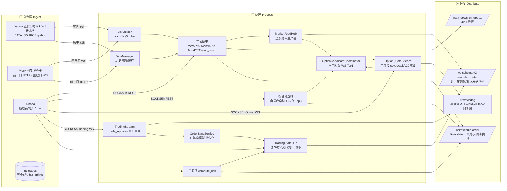

# TT Trading 数据流全景：拿数据 → 处理 → 分发 → 逻辑

> **更新时间**：2026-08-10（Alpaca 全链 SOCKS5h；Option WS 负责报价；
> TradingStream WS 负责交易终态；REST 负责动作、首帧与定时真源对账；
> 原始 datasource 与规则/选约/MarketContext 分层；OrderSync 消费交易事件并写订单账本；
> watchdog 支持旧卖单风险抢占和防超卖，交易终端使用版本化共享 patch 与真实 dirty 分区渲染）。
> 配套代码审查与更新日志见文末「已知问题与约束」。

---

## 0. 总览图

交易终端固定使用 `WatcherDataSource`（进程内直连 `GLOBAL_WATCHER`），不再提供
`real` 历史库练手档或前端运行时切源。实时 tick 与 K 线入口由服务端环境变量
`DATA_SOURCE=mock|yahoo` 选择（另有 `uw`/`massive` 两条实时分支，无历史源）；切换后重启服务即可。
**LES 档已于 2026-08-15 整体删除**（`app/integrations/les/`、`app/les_option_stream.py`、
`quote_loops.py` 的 4 个 `_les_*` 函数、`watcher_manager` 选路分支、`LES_API_KEY` 全部移除）：
用户 2026-08-08 决定弃用后代码休眠了一周，`DATA_SOURCE=les` 不再是合法取值。

---

## ① 拿数据（Ingest）

| 数据 | 来源 / 函数 | 说明 |
|---|---|---|
| 正股/指数实时 tick | **`_yf_quote_loop` (Yahoo，默认)**；另有 `_uw_ws_quote_loop` / `_massive_ws_quote_loop` | 根据 `DATA_SOURCE` 环境变量切换（`quote_loops.py::QuoteLoopsMixin`）。**LES 分支已于 2026-08-15 删除。** |
| 正股/指数实时 tick（回放） | `_mock_ws_quote_loop`（`DATA_SOURCE=mock`） | 盘外全链路测试用：连 `ws://127.0.0.1:9000/sim/stream`；引擎自动发现 `trading_test/data/replay/*.parquet`（当前 32 只 Alpaca IEX 正股/ETF，`^VIX` 特殊处理），读取选定的**单个回放日**并拆成 tick，按历史时间戳同步推进全部标的；前一共同交易日只用于 HTTP 预热，收盘后必须显式 reset，绝不首尾循环。`REPLAY_DATE` 可指定；未配置时选全部标的共同具备的最新交易日。每帧 `timestamp` 是强制字段，`_mock_extract_ticks` 解析为带时区 `datetime` 并一路传给 `TickerWatcher.process_tick` / `BarBuilder.update`；缺失或无时区就丢弃，不能回落墙钟，否则 60 倍回放会把约 60 根历史 1m bar 压成一根墙钟 bar。走本机故**关闭代理**。期权链、bid/ask 与 Greeks 不下载，按当前回放正股价和虚拟盘中剩余时间用 Black-Scholes 现算。 |
| 历史预热 / 缺口回补 | `DataManager.download_history()` **按 `DATA_SOURCE` 分流** | `mock`→`GET /sim/history/{symbol}`，只取回放日前一个可用交易日的 RTH bar；mock 明确跳过生产 `.cache` 的加载、补缺和保存。**其余一切取值（含默认 `yahoo`）→yfinance**。 **断层要等补齐再返回（2026-08-28）**：`warmup()` 建补齐任务后 `await` 它，上限 `WARMUP_FILL_WAIT_S`=20s，超时才转后台。原先是纯后台任务，`warmup()` 立刻返回，`TickerWatcher.start()` 紧接着拿旧 K 线算出第一份状态就发布了 —— 08-28 崩溃重启现场，缓存停在盘前 09:27（`.cache` 只在预热/补齐/优雅退出三处写盘，崩溃没写），而 Yahoo 盘前分钟线成交量恒为 0，流动性硬闸当场把 13 只票全判「不可交易」。 **触发入口有两个**：启动时按名单批量预热（`main.py` lifespan）；盘中手动加票时单只预热（`POST /api/watchlist`，2026-09-05 起该接口先 `await add_ticker()` 补完 K 线才写名单，预热失败直接回 400 不写库）。 |
| 正股分钟线（live 档） | `AlpacaData.rth_bars(ticker)` | Alpaca Market Data，20s 缓存 |
| 盯盘状态新鲜度 | `TickerWatcher.get_state()` → `data_age_s` / `data_stale` | **（2026-08-28 新增）** 最新 1m K 线比现在旧超过 `STATE_STALE_AFTER_S`(180s) 即判落后，**在读取时刻算**（状态停止刷新本身就是要抓的情况）。判据只有这一份：下单硬闸 `market_context.signal_from_payload(require_tradable=True)` 抛「盯盘数据落后」、卡片 `feed_snapshot._dry_gates` 两侧同拦 rule=`stale`，两边只读结论。K 线戳是**起始时间**，正常年龄本就在 60~120s，阈值必须留够一根 bar 的余量。mock 回放不判（回放钟与真实钟不同源）。 |
| 合约候选 / 到期 / 余额 / 时钟 | `AlpacaData.contract_candidates / nearest_expiry / buying_power / clock` | Alpaca REST；**`nearest_expiry` 的筛选下界取 `clock().session_date`（美东交易日），不是本机日期（2026-08-15 修）** —— 本机在 UTC+8 时，美东 12:00–16:00 ET 正对应北京次日 00:00–04:00，`dt.date.today()` 已跳到次日，会把当天到期的 0DTE 整段过滤掉：**不报错，静默选到次日到期的合约**，希腊值与定价口径全偏；候选按精确到期日、已知 CALL/PUT 与 strike 范围过滤，宽度常态 ±0.5%，无合格项才扩到 ±1%/±2%/±6%；`SPX` 日到期链在集成层映射为 `SPXW`。**429 退避（2026-08-11 新增）**：全部只读取数经唯一收口 `AlpacaData._cached()`，撞 `too many requests` 时退避 0.25s→0.5s 重试，最多 2 次；非 429 立即抛出不浪费点击路径时间。**下单/撤单在 `trading.py`，一次都不重试** —— 429 之后原请求可能已到券商，重试会重复下单（`tests/test_alpaca_rate_limit_retry.py` 守住这条边界）。**SDK 自带重试必须留着（2026-08-14 当天立、当天推翻）**：曾判定 alpaca-py 默认的 `retry_attempts=3 / retry_wait_seconds=3 / codes=[429,504]` 是 `contract_ms` 3.5s 尖峰的病因并用 `_harden()` 置 0 —— **诊断对、结论完全错**：那 3 秒不是病是药，关掉当晚 429 从 ~3 次/天暴涨到 **280 次/分钟**（连续 41 分钟、合计 11,055），代价是 10 笔下单被 429 拒掉 + 一个永久幽灵仓。`_harden()` 已整体删除，`client.py` 回到 `6a4600b` 原样，本层退避 `_RATE_LIMIT_BACKOFF_S` 只是它之下的补充。红线钉在 `tests/test_alpaca_sdk_retry_kept.py`，改动前必读。**挂起超时已于 2026-08-25 单独加回**（见下方 watchdog 段的说明），加的只是 timeout，`_retry` / `_retry_wait` 一个字没动|
| 期权链取数慢样本埋点 | `AlpacaData.contract_candidates` → `chain_fetch_slow` | **（2026-08-14 新增）** 总耗时 ≥ `_CHAIN_SLOW_LOG_MS`(**2500ms**) 才落，且同一 `(ticker, direction)` 按 `_CHAIN_SLOW_LOG_THROTTLE_S`(60s) 节流、窗口内被吞条数带在下一条的 `suppressed` 上。**阈值初版定 500ms，当晚盘中即被推翻**——现场样本 `COIN short chain_ms=527.9 chain_calls=1` 只是一次正常代理往返，几十个 ticker 一起刷屏；基线中位 330ms、正常尾巴到 1s，要抓的是 3.5s。节流必须自带：项目的 `RepeatSuppressFilter`（`core/event_stream.py:294`）只对 WARNING 以上生效，INFO 事件不受它保护。四种慢法各有唯一签名：`chain_calls≥2` = 逐档扩宽的串行往返；`chain_calls==1` 且 `chain_ms` 高 = 单次调用慢；`expiry_ms` 高 = `nearest_expiry` 那一发 REST；`other_ms` 高 = 429 退避 sleep（sleep 不产生任何日志行，只能靠残差看见） |
| 期权 Bid/Ask 增量 | `OptionQuoteStream` | 全进程单条 Alpaca Option WS；`positions`、`candidates:*`、`recording` 分 scope 去重，硬预算 120。服务端 `subscription` 确认后才更新 confirmed；候选每票常驻 Top1，换档短暂新旧 Top2。ticker 已有 open/closing 持仓时释放对应 `candidates:*` scope，实际持仓合约继续由高优先级 `positions` scope 独立订阅 |
| 交易账户订单事件 | `TradeUpdateStream` → alpaca-py `TradingStream` | Alpaca paper `trade_updates` 单连接；推送 accepted/new/partial_fill/fill/canceled/rejected/expired。传输层只规范化事件、写线程安全缓存、通知 `OrderSyncService` 并唤醒 watchdog；不认识 `JOURNAL`，也不承担下单/撤单或数据库写入 |
| Alpaca SOCKS5 延迟探针（独立诊断） | `scripts/benchmark_alpaca_socks5.py` | **不进入交易业务链**；默认经 `socks5h://127.0.0.1:1080` 每 5 秒测 SPXW 窄链 REST、WS Ping/订阅/首条 Quote/取消确认，运行前必须停主服务以免争抢单条期权 WS；原始与汇总结果写入 `data/benchmarks/` |
| 真 delta ③ | `contract_candidates` 内 **Alpaca** 期权快照 Greeks（`app/integrations/alpaca/data.py`） | 同一次期权链带出；缺失时使用贴平值近似 0.50 并标记 `delta_source=approx`，前端只提示「Greeks 暂缺」。⚠️ **这条与 UW 无关、仍然在跑**：2026-08-15 删的是 `UwClient.deltas()`（零调用方），不是这条。规则 9 的 delta 门槛吃的就是它——但 `ALPACA_OPTION_FEED=indicative` 档不填 greeks（实测 23/23 全 approx），0.50 兜底恒过门槛，签 OPRA 前该门槛形同虚设 |
| GEX 结构位（纯展示） | `UwClient.gex_levels(ticker)`（`gex_wall_service.py` 30s 一轮轮询） | **2026-08-15 重建为纯展示服务**：后台独立并发轮询 UW REST `gex-levels`，取 `call_wall`、`put_wall`、`gamma_flip`（零 Gamma 线）三个绝对价格字符串，由交易终端 WebSocket 下发 `walls` section。前端每 tick 根据实时价重算距墙百分比（`((wall - price)/price)*100`），**Net GEX（+/−GEX）同理由前端现算**——拿实时价跟 `gamma_flip` 比大小，价格在其上判 `+GEX`、之下判 `−GEX`，是简化判断不是 UW 给的精确美元敞口值；没有为它另接 UW 的 `spot-exposures` 接口（会让每轮请求量翻倍，中转站已吃紧）。**纯展示，不接任何交易闸门**（规则 7b/触墙止盈保持下线状态）。 **节拍（2026-08-17 当天调整两轮，此前为 30s/15s/8s）**：轮询间隔 15s 试了一下、复盘中转站阵发性抽风（同轮 25+/33 只同时超时,不是差一点点没赶上)的真实日志后**改回 30s**；整轮硬超时改小到 10s（单独确认过的偏好，不随轮询间隔改动跟着弹回）、单请求 8s（余量收窄到 2s，阵发性大批超时时第二批任务常来不及单独超时就被整轮上限切掉转 stale，属预期行为）、并发 16、缓存上限 12s（虽然间隔已改回 30s，12s 仍 < 30s 不违反约束，没必要跟着弹回 25s）。 **不是每只票都有 GEX**：`^` 开头的指数代码（`^VIX`）静态跳过——它来自 `config.MARKET_STATUS_TICKERS` / `pool_screener.CONTEXT_TICKERS`，是故意留在池子里的大盘 context，不可交易也没有期权链，UW 对它明确回 422。其余靠 `UwUnavailable.status_code` 学习：**仅 404/422** 记入 `_UNSUPPORTED` 永久跳过，5xx/429/401/403/超时一律视为临时故障、下轮照常重试（中转站整站 530 时若按失败拉黑，恢复后前端将永远空白）。2026-08-17 实盘首次观测到 `active_ip_limit_exceeded`（该 Key 同期最多 2 个客户端 IP）——同一时段直连/代理测试脚本与正式进程并发访问导致，未记入永久跳过（走 5xx/429 同一条临时故障分支） |
| 正股实时行情（`DATA_SOURCE=uw`） | UW WS channel `price:{ticker}` → `QuoteLoopsMixin._uw_price_channel` → `_ingest_tick` | 走 `app/integrations/uw_ws.py` 的 `UwWsPool` 路由订阅，不自建连接。payload `{"close":"773.85","time":<epoch毫秒>,"vol":<当日累计成交量>}`——`close` 是字符串、**`vol` 是累计量必须差分成单笔量**、**payload 里没有 ticker**（从频道名取）。⚠️ **容量约束（2026-08-07 连接池自动扩容改造后）**：`ticker` 组组内按需扩容——一个分片（连接）订满 `MAX_CHANNELS=12` 条频道就自动开下一条，直到全局硬顶 `MAX_CONNECTIONS=8` 条（跨组合计，保守取值非实证结论）。扣除 `flood`/`global` 各占 1 条，`ticker` 组可用约 **6 条 × 12 = 72 只**。容量不再写死在本模块，`_uw_ws_quote_loop` 每轮向 `uw_ws.remaining_capacity(GROUP_TICKER)` 查询，池子是唯一权威。指数标的（`^VIX` 等）不占容量——UW 没有对应的 `price` 频道，已过滤。盯盘池（当前 153 只）远超 72 只，超出时**拒绝启动并打 ERROR**，绝不静默只订前 N 只；生产池请用 `les`/`yahoo`（当前 `.env` 为 `DATA_SOURCE=les`，本路径未启用）。详见 [docs/uw/UW_WEBSOCKET_接入规范.md](uw/UW_WEBSOCKET_接入规范.md) |
| Market Tide 资金潮（实时） | UW REST `/api/net-flow/expiry?expiration=zero_dte` → `TideRestState`（30s 一轮轮询） | **2026-08-15 从 WS 迁回 REST**：WS 实测天花板 2.02 次断线/小时、存活中位 11 分钟，增量丢失导致误差单调累积。REST 每分钟一根、同名字段**就是当日开盘至今的累计值**，30s 轮询直接替换 `TideRestState`，彻底省掉 base/delta 拆分与对齐逻辑。**2026-08-18 由全市场 `/api/market/market-tide` 切到 0DTE 专属 `/api/net-flow/expiry`**：响应两层嵌套（`data[0].data` 才是点列表，分组维度是 `tide_type × moneyness`、与 expiration 无关）、`timestamp` 改为 UTC 带 `Z`（旧接口是 ET 带 `-04:00`）、`date` 参数实测有效（盘前回填靠它）。展示口径 `diff = 累计 net_call - 累计 net_put`，广播徽章与 0 轴滞回穿越提醒。⚠️ **量级比旧口径小一个数量级**（0DTE 日间摆幅实测 ±20M，旧口径 ±100M～750M），故 `cross_hysteresis_usd` 于 2026-08-20 **由 5M 重标为 1.0M**（六日序列扫描：5M→4 次、2M→9 次、1.0M→15 次约 2.5 次/天、0.75M→21 次）|
| Market Tide 交易页顶栏徽章 | `trading_ws.py::_capture()` 读 `current_accumulator()` → `/ws` 的 `tide` section | **2026-08-20 加**：交易页顶栏 PAPER 右侧显示当前 0DTE 净额。与距墙同一形态的纯展示 section —— 只读 `market_tide_service` 的状态，不另发请求、不另做累加。`with_series=False`（顶栏不画走势图，390 点数组白占带宽）。**token 只取 (diff, direction, seeded, session)**：`tide_snapshot` 的 `ts` 每次 capture 都变，整体比较会退化成每 0.5s 推一帧。前端走 `refreshTide()` 定点改节点、**不排渲染** —— 顶栏不在任何 `data-render-region` 内，软渲染够不着，而硬渲染会重建整棵 DOM（2026-08-17「设置页中文打不进字」的成因）。`seeded=false` 时显示 `--` 而非 `持平 $0.0M`，避免「还没数据」和「真的多空平衡」在徽章上分不清 |
| Market Tide 盘前启动回填 | `seed_previous_session()` → `load_tide_day()` 逐日往前找最近一个交易日终值 | 进程若在盘前启动，用最近一个有数据的交易日（跳过周末与休市）回填终值，标记为 `prev` 场次推给前端，避免盘前重启后徽章显示 `--` 或显示为实时值 |
| 已平仓成交 ⑦ | `services.account_state.closed_trades()`（`ttt_trades` 历史成交） | 本地进程内缓存 + 平仓重置；启动时支持从数据库重建 `OrderJournal` 订单流。 |

> **代理取值以 `.env` 文件为准（2026-09-01 起）**：`config.proxy_setting()` 让
> `HTTP_PROXY` / `SOCKS5_PROXY` 反向优先——`.env` 文件压过进程环境变量（其余配置键
> 仍是环境变量优先，mock 联调靠 `DATA_SOURCE=mock` 这类临时覆盖）。起因是系统里
> 残留了一个用户级 `HTTP_PROXY=http://127.0.0.1:1080`，`data_manager` 当时用
> `setdefault` 注入，于是 Yahoo 一直走系统那个、改 `.env` 毫无反应且无任何日志。
> `.env` 里只写 `host:port` 由 `config.normalize_http_proxy()` 补 `http://` 前缀；
> **已带 scheme 的一律原样保留**，否则 Alpaca 的 `socks5h://…` 会被拼成
> `http://socks5h://…`。Massive/UW 的 WS 代理（`quote_loops._get_proxy_url()`）也改读
> `config.HTTP_PROXY`：Alpaca 的 `apply_proxy()` 会覆盖全进程 `HTTP_PROXY`，再读
> `os.environ` 就会拿到 SOCKS5 地址。
>
> 所有外部接口均按 `.env` 代理配置请求。Alpaca 与 UW (Unusual Whales) REST 接入
> 显式统一使用 `SOCKS5h` (如 `socks5h://127.0.0.1:1080`) 将公网域名委托远程代理服务器完成 DNS 解析，杜绝本地主机 `11001` 旁路中断；
> `127.0.0.1,localhost` 保留在 `NO_PROXY`，本地 Mock 不绕远。
> **UW 2026-08-17 曾短暂改直连又改回代理**：跑满 10 分钟的真实对照显示直连
> 与代理成功率相当（90.3% vs 90.7%），但直连延迟明显更高（中位数 2844ms、
> p90 4516ms），代理留的余量更大，故改回代理；同时把距墙服务单请求超时
> 从 5s 调到 8s 兜住偏高的延迟尾部。

---

## ② 处理 / 计算（Process）

**Bar 合成**：`BarBuilder.update(price, vol)` 把 tick 切成 1m OHLCV bar；`resample_to_5m` 生成 5m。`current_bar` 含实时 `last_price`（每 tick 更新）。

**市场数学 — watcher 档**（`TickerWatcher._recalculate_minute_state`，**每 1m 收盘重算一次**，结果存 `_minute_state`，WS/validator 0 毫秒读取）：
- **VWAP**：当日 **RTH（09:30–15:59 ET）开盘至今全量**，典型价 `(H+L+C)/3` 按成交量加权累计
- **VWAP σ Band**：成交量加权标准差 $\sigma_{vwap}$，与 VWAP 同一段 bar。**2026-09-01 起纯展示**：追高闸（原规则 7，判据 `|price − vwap| >= k×σ`）当日删除，这个数现在只用来在票池卡片上显示「距 VWAP ±x σ」
- **σ 的 ATR 地板**（2026-08-08）：实际下发的是 `σ_eff = max(σ_session, VWAP_SIGMA_ATR_FLOOR × ATR14)`，系数 1.0（**常量 2026-09-01 由 `CHASE_SIGMA_ATR_FLOOR` 改名**：追高闸删了，留着以已删规则命名的常量会让下一个人以为那道闸还在；地板本身保留，没有它开盘卡片会显示「≥99.9σ」这种没意义的数）。σ_session 的样本随交易日从 0 根 bar 长起，开盘早段是高方差估计且落在偏离倍数的分母上——实测 12 标的 × 43 天 × 19.6 万分钟判定点，开盘 1-10min 拦截率 22.8%（第 2 分钟 47.5%），而 31-60min 仅 7.5%。加地板后 1-10min 降至 5.9%，31-60min 只由 7.5% 动到 7.3%。地板只在 σ 未长起时生效，长起来后 `max` 自动失效。σ 为 None（盘前/跨日失效）时保持 None，不得凭空造分母。两条生产路径（`watcher_manager._recalculate_minute_state` 与 `market_context.signal_from_payload`）共用 `market_state.sigma_with_atr_floor()`，口径不得漂移。
- **ATR**：最近 14 根 True Range 的简单均值（1m）
- ~~**ER**：Kaufman 效率比~~ / ~~**ema_dir**：1min 与 5min 的 EMA9/21 方向~~ / ~~**macd_hist_closed / peak / shrinking**：5min MACD 动能~~
  —— **2026-09-01 三组一并删除，watcher 不再计算也不再下发**。它们分别是震荡闸（规则 5）、
  方向闸（规则 6）、动能闸（stall）的判据，四条闸同日下线（原因见 [README](../README.md#入场闸门2026-09-01-起)）。
- **trend_score**：`trend_score(df_1m)` → `{score, direction, label, regime_factor, tradable, primary_score, primary_direction, impulse_score, phase, data_quality_ok}`

> **趋势分主副双层（2026-08-02 改造）**：
> - **主趋势 `primary_*`**：5min 重采样层，`0.70×slope×√R² + 0.30×EMA排列`，再经双阈值迟滞状态机（`enter=0.50 / exit=0.25 / persist=2`）得到 `primary_direction`。
>   ~~这是 validator 规则 5（震荡）/规则 6（反向）唯一的方向来源~~ —— **本段整体作废**：趋势分 2026-08-26 下线、接手它的 EMA 共振与效率比 2026-09-01 下线，闸门现在不看方向。
> - **短线冲量 `impulse_score`（= 旧 `score`）**：1min 层 composite，供 UI 与策略择时，**不再喂闸门**。
>   旧 `direction` 字段保留为冲量方向，闸门已不消费。
> - **`phase`**：`advancing/pullback/bounce/pause/chop`，由主趋势 × 冲量推出，仅用于展示标签（"空头趋势·反弹中"）；
>   反弹/回调**不改变**主趋势——是否等反弹结束再入场交给信号策略，而非趋势闸门一刀切。
> - **`data_quality_ok`**：从 `tradable` 拆出的行情质量/流动性位，作为下单硬闸门入参（`market_context.signal_from_payload`）。
>   `tradable` 原注释语义是「跨标的排序地板」，被当硬闸门用会造成莫名禁交易，故拆分；旧键保留兼容。
>
> **固有限制**：5min 主趋势在趋势转折点滞后约 25–30 分钟（实测 0730 QQQ 价格 10:30 见顶、10:55 已跌 4 美元，主趋势 11:00 才转负）。
> 这是 1 小时回看窗口的固有属性，缩短窗口会让噪声与反向率同时上升（lookback 12→8 时反向率 10%→26%），故不缩短；
> 转折期的可见性由 `phase = pullback/bounce` 表达。回放验收脚本：`scripts/replay_trend_gate.py`。

> **两个窗口口径不同，不可混用**（2026-08-01 修）：
> VWAP/σ 走 `session_rth_bars()` 取**当日 RTH 全量**（锚定量，左边界钉死 09:30）；
> ATR/ER/trend_score 走 `get_df_1m(tail=300)` 的**滚动窗口**（只看近端）。
> 此前两者共用同一份 300 根切片：当日 bar 自 04:00 起算（Yahoo `prepost=True` 带盘前），
> 14:30 ET 后窗口左边界越过 09:30，session VWAP 退化为「5 小时滚动 VWAP」。
> 实测 SPY 2026-07-31 收盘：真值 744.501 / 截断值 745.821，偏 **0.45σ**（追高闸阈值仅 2σ）。
>
> 盘前 bar 现为**显式过滤**。Yahoo 1m 盘前只给价格不给成交量（`volume` 恒 0，
> raw chart API 7 组参数实测全为 0，盘后则有量），此前靠权重为零「碰巧」排除；
> 口径与 TradingView 的 Session VWAP 一致，不再依赖数据源的这个偶然性质。

**市场数学 — live 档**（`app/market_state.py`）：`session_vwap / vwap_sigma / sigma_with_atr_floor / atr`，输入 Alpaca RTH bars。（`efficiency_ratio` 与 `ema_direction` 2026-09-01 随闸门一并删除。）

**合约选择 ③**：
- `contract_candidates()` 由服务端先按到期日、Watcher 已确定的 CALL/PUT 和窄 strike 带过滤；
- `services.contract_selection.shortlist_contracts()` 按真实 Delta、Spread、`ask × 100`
  单手成本排序，内存最多保留 Top3；datasource 只提供原始候选；
- `OptionCandidateCoordinator` 只把第一名放入 WS。硬闸门立即释放，易抖动闸门延迟 3 秒；
  方向/模板/价格移动 ≥0.5% 或 identity 到期时重选，换档先订新、确认后退旧；
- ticker 进入已持仓状态后候选协调器发布 `HELD`、清空候选 scope，不再继续筛选换档；
  清仓后下一次协调即清除旧 `HELD` 展示，重新选约仍遵守稳定窗口；
  watchdog 仍把真实持仓 OCC 合约放入 `positions` scope，候选信号与持仓行情互不覆盖；
- 完整 validator 下单前仍重跑全部规则，仓位与购买力按可成交 `ask` 而非 mid 估算。

**距墙 / 触墙止盈（2026-08-11 已删除）**：`wall_room` / `tp_from_walls` / 规则7b /
`tp_price` / `tp_wall_enabled` / `UW_GEX_ENABLED` 全部移除。`UW_GEX_ENABLED` 自
2026-07-26 起即为 `False`，删除前这两条消费链已恒收 `None`（规则7b 从未拦过单、
新仓从未设过触墙 TP），故删除是清死代码、**零行为变更**。
0DTE 的出场自此只有三条线：百分比止损 / 美元止损 / 最长持仓超时。

**风控聚合 ⑦**：`compute_risk(trades, now, active_template.cooldown_seconds)` → 日/周 PnL、连亏数、冷却剩余；支持重启时从数据库回放历史成交重建状态。2 连亏触发冷却，冷却结束时该轮连亏一并归零，后续亏损从 1 重新计数。

---

## ③ 分发（Distribute）— 四个出口

| # | 出口 | 触发 | 载荷 | 消费方 |
|---|---|---|---|---|
| 1 | **TT 交易终端** `/ws` | `MarketFeedHub` 每 1s 只生成一份全票池行情；`TradingStateHub` 每 0.5s 刷新状态并维护 section revision；`TradingWsHub` 每帧只编码一次，以独立容量 32 队列供所有客户端发送；浏览器每 5s Ping/Pong | 首帧 `{schema_version:2,type:'snapshot',seq,revisions,...}`；后续 `patch` 只含变化的 `feed/orders/positions/risk/broker_sync/options`，缺失 section 表示未变化；队列溢出改发最新 snapshot | `static/app.js` 按 revision 消费；patch 序号断档时重连。软刷新直接从模板构建 dirty region，不再生成全树后丢弃 |
| 2 | **4in1 盯盘看板** `/watcher/ws` | 路由通过 `WatcherManager.set_callbacks()` 注册消费者；业务层只发布状态/信号 | `{type:'update', ticker, data: full_state}` | `static/watcher/` 前端组件 |
| 2b | **盘中快讯滚动条** `/watcher/ws` | `news_feed_service` 08:00–16:05 ET（**含盘前**）每 60 秒轮询 UW `/api/news/headlines?sources=Tradex`；去重后攒批（≤8 条）送模型翻译分档，阻塞调用走本模块专属线程池（单次 15~65 秒，不占默认 executor）| `{type:'news', data:[{ts,et,cn,en,lv,dir,translated}]}`，**只推最高档**；新连接由 `_send_news_snapshot` 补发内存队列（上限 20）| `static/watcher/` 顶部横条滚动 + 声音。模型不可用退回关键词兜底、显示英文原文并标未翻译。纯展示不接策略 |
| 3 | **交易动作 ④⑤** `/api/execute-submit`·`/api/close`·撤单等 POST | 前端按键；买/卖/加/减/撤仍通过 Alpaca Trading REST 受理 | `services.market_context` → validator → `OrderGate` 闸门校验 | `exec_entry.py` / `exec_close.py` / `atomic_close` 执行动作；最终订单状态由 TradingStream 推送 |
| 4 | **持仓 watchdog ⑥⑦** | TradingStream 事件立即唤醒；无事件仍每 1s 跑止损时钟 | trade_updates + Option WS 实时价；连通时每 30s REST 持仓对账，断线时每 1s REST 兜底，重连立即补账 | 部分/全部成交、撤单/拒单确认、自动止损与超时离场 |

> **下单自查随请求上行（2026-09-01 新增）**：`POST /api/execute-submit` 的请求体多了一个
> 可选字段 `self_check`（`{chop, conflict, chase, dwell_ms, flips}`）—— 买入前弹窗里那三个
> 开关的答案，外加弹窗停留毫秒与开关拨动次数。`OrderRequest` 是 `extra="forbid"`，所以它必须
> 在模型上显式登记。**后端只记录不强制**：三个都答「是」的请求照样往下走闸门，脚本与
> `/api/execute` 同步端点不带这个字段也不受影响。它在 `exec_entry._entry_snapshot()` 里被并进
> 生效模板快照，最终落到 `ttt_trades.template_snapshot` 这个已有的 jsonb 列 —— **不新开表、
> 不加列**。前端侧只在**开仓**路径弹窗；`/api/close`、`/api/add`、撤单都不经过它。

> **启动时的持仓恢复（2026-08-15 新增）**：`REGISTRY` 是纯内存态，进程重启即清空。lifespan 现在会在
> **watchdog_loop 启动之前** `await exec_reconcile.recover_positions_on_startup()`，把券商实持仓恢复回
> `REGISTRY`。此前启动路径只调 `reconcile_pending_journal()`（仅对账在途未决订单），能恢复持仓的
> `reconcile()` 仅挂在 `POST /api/reconcile` 上 —— 2026-08-14 23:49 带仓重启实测**失明 2 分 35 秒**、
> REST 对账连报五次 `active_positions: 0`，QQQ 的 15 分钟超时晚触发 3 分 40 秒。
> 判据完全复用 `reconcile()`（数据库无记录的外部仓仍拒绝接管、券商聚合量多出部分仍按外部仓忽略），
> 自动化的只是调用时机；不可执行数据源（mock 回放）跳过，券商不可达只告警不阻断启动。
> 「恢复完成前不得开新仓」由调用位置保证：uvicorn 在 lifespan 启动段跑完前不 accept 请求。

> **Alpaca REST 强制超时（2026-08-25 新增）**：`app/integrations/alpaca/client.py` 现在给三个 SDK
> 客户端的 `requests.Session` 注入默认 timeout，**按用途分两档**，调用方显式传的不被覆盖：
> **交易档** `(5s, 15s)` —— 下单/撤单/查单/查持仓，watchdog 走这一档，实测最慢 1.29s，必须收紧；
> **行情档** `(5s, 45s)` —— 期权链/到期日/批量报价，单发请求真的会跑到 16 秒
> （08-21 META `chain_ms=16233` 且 `chain_calls=1`、08-24 AMD `expiry_ms=16217`），
> 它在**开仓选约**路径上，按 15s 砍会让人开不了仓；放宽但仍有上限。
> 覆盖键：`ALPACA_REST_CONNECT_TIMEOUT_S` / `ALPACA_REST_READ_TIMEOUT_S` /
> `ALPACA_REST_DATA_READ_TIMEOUT_S`。
> **为什么必须有**：alpaca-py 的 `RESTClient` 调 `self._session.request(method, url, **opts)` 时
> opts 里**没有 timeout**，requests 收到 `None` 就是无限期等；请求又走 SOCKS5 代理，连接被挂住时
> 只能干等对端掐断。而 `watchdog_loop` 是 `await asyncio.to_thread(_watchdog_tick, ...)` 串行一个
> 线程 —— 一发请求卡死 = 整个 watchdog 停摆，止损/超时平仓/触墙检查/成交回填全停。
> 2026-08-25 实测卡了 **8 分 48 秒**（23:01:55 → 23:10:43，恢复时抛 `RemoteDisconnected`）：期间一笔
> 23:06:34.551 就已在券商成交的 QQQ 认沽，在持仓总览里空窗 4 分 09 秒 —— 用户看不到也砍不掉，
> 同一时刻订单流面板却显示「已成交」（订单流走 `services/order_sync.py` 事件队列，与 watchdog 无关）。
> 历史日志里同形态的静默共 13 次，最长 55 分钟。
> 配套两条：① `watchdog.WATCHDOG_TICK_SLOW_S`（默认 10s）超时打 `watchdog_tick_slow` 告警并报耗时
> ——此前一拍没跑完就永远不打日志，只能靠心跳断档反推；② `POST /api/reconcile` 增加
> `_resolve_pending_entry_fills()`，把「券商已成交、登记表还停在 pending」的仓转成持仓，
> 结果在 `resolved_pending` 字段返回。此前对账只找孤儿仓（券商有、登记表完全没有），
> 而这类仓登记表里**是有的**，正好落在盲区里 —— 用户点对账没有任何效果。

### ~~SOS 双期限候选管线~~ / ~~SOS exit_lines 三线出场提醒~~（2026-08-15 整体移出）

SOS（Swing Option Screener）是 2026-08-07 从独立项目 `D:\Dev_project\SOS v3.0` 移植进来的**旁路**子系统，与 0DTE 交易系统解耦共存。**2026-08-15 已整体移出本项目**——原因是项目复杂度失控、该策略本身有问题（`SOS_ENABLED` 自 2026-08-13 起就已关闭）。

**完整备份在 `D:\SOS_BAK`**（按项目相对路径原样存放，另附 `还原说明.md`）。本节原有的两大块内容——`0–1 DTE` 精确 OCC 候选管线（flow-alerts WS → Alert Detail 清洗 → exact-OCC 逐笔压力窗口 → 数据库投影 → SSE `sos_candidates`）与 exit_lines 三线出场提醒（VWAP 破线 / 30 分钟持有硬顶 / 15:45 ET 强平，只提醒不下单）——连同其口径细节一并归档在备份里，需要时从那里查。

**移出后对本项目数据流的实际影响，只有下面四条：**

1. **UW WS 订阅减少三条**：`contract_screener` / `flow-alerts` / `off_lit_trades` 三个 payload-only 频道不再有消费方（原 `sos/feeds.py`），连接池预算相应释放。`market_tide` 频道**不受影响**——它归 `market_tide_service.py`，SOS 当初只是读它的累加器，从不另开订阅。
2. **Market Tide 少了一个消费方**：原 `/api/sos/state` 的 `market_state.net_premium`/`bias` 展示出口消失，累加器本身与盯盘页徽章照常。文档中「`prev` 场次不进决策」的口径仍然有效（当时唯一的执行点 `SosEngine._rank_once()` 已随之移出），将来若有新消费方接入 bias 必须沿用。
3. **本项目暂时没有任何 SSE 长连接端点**：`/api/sos/stream` 是全项目唯一的 SSE 出口。`app/lifecycle.py` 的关停信号机制（`SHUTDOWN` 事件 + 信号钩子）**保留且仍在服役**，将来新增 SSE 端点直接复用，无需重新设计。
4. **未登记持仓扫描口径变了**：`exec_reconcile.list_unmanaged_positions()` 不再向 SOS 账本查持仓做扣减（`_sos_position_qtys()` 与输出字段 `same_contract_sos_qty` 已删）。故券商侧若残留 SOS 时期的 swing 仓，**会被列进「未登记持仓」表**——只读展示不平仓，但切勿点「找回」，拉进 `REGISTRY` 等于交给 0DTE 风控按 0DTE 止损纪律处置，须到券商端手动处理。

**保留的残留防护（三处，勿清理）**：券商账户里可能还有未终态的 `sos-` 挂单，而已无 SOS 面板可管，因此订单前缀分流必须继续生效——`broker_pnl.SIBLING_PROGRAM_ORDER_PREFIXES = ("sos-",)`，及其在 `OrderJournal._upsert_broker_orders_locked()`（整条丢弃，唯一执行点）与 `exec_close.cancel()`（403 拒撤，对称归属闸）的两个消费点。

**数据库侧未动**：`sos_strategy_config_versions` 等表保持原样，迁移脚本 `2026-08-10-sos-zero-one.sql` 已移入备份，应用不再连接这些表。
### 交易审计出口

交易动作统一写入 `log/ttt.log` 的 `[tt.trade]` JSON 行。`intent_id` 串联前端买入
受理与真实入场 `order_id`；平仓/减仓用 `close_order_id` 指向券商卖单，并保留入场
`order_id`。事件覆盖闸门拒绝、委托、每次追价、成交、加减仓、撤单请求/失败/
`cancel_pending`/确认、watchdog 触发和最终 PnL。撤单事件额外携带稳定的
`cancel_cause=manual|timeout|risk_preempt`，前端不再从中文原因反推音效。每行自动携带 `data_source`，
便于区分 Mock 与真实行情；不记录密钥、数据库连接串或完整券商响应。

**下单耗时埋点（2026-08-11 新增）** —— 用于定位「点提交后慢」：

* `entry_context_timing`（`market_context.build_market_context`）：闸门取数各步的毫秒数
  `signal_ms` / `contract_ms` / `account_ms` + `total_ms`。
  走 `finally` 出事件，被拒的单同样留痕 —— 慢样本多数最终是拒单。
* `execute` 事件新增 `gate_ms` / `quote_ms` / `owner_check_ms` / `submit_ms` 与
  `pre_submit_ms`（前三者之和，即「点击到券商收到单」）；`trade_gate_rejected` 与
  `execute_gate_error` 也带 `gate_ms`。
* 判读口径：08-10 实测券商 `submitted→filled` 仅 55–500ms，若 `pre_submit_ms` 远大于
  `submit_ms`，问题就在本地取数链而非券商。背景见
  [docs/reports/2026-08-11-下单卡顿与拦截诊断.md](reports/2026-08-11-下单卡顿与拦截诊断.md)。

---

## ④ 核心逻辑与铁律（数据侧）

- **盯盘失联 → 下单硬锁**：`services.market_context.build_market_context()` 通过原始数据源
  的 `signal_online()` 检查盯盘状态，未启动即拒所有新开仓；持仓监控不受影响。
- **追高闸基于 VWAP 2σ Band**：淘汰旧有 ATR 归一化偏离值，采用 $\sigma_{vwap}$ 标准差带宽控制追高拦截。2026-08-08 起 σ 带一条 ATR 地板消除开盘早段的小样本失真（详见上文「σ 的 ATR 地板」）——注意这是给 σ 加下界，**不是**退回旧的 ATR 归一化口径。
- **买入与平仓全链路异步受理**：前端提交秒回 `accepted`，后台线程池异步处理风控与追单，不阻塞 HTTP 主线程；受理号解析仍作短时状态查询，订单/持仓最终状态统一经 `/ws` 推送并驱动通知音效。
- **卖出挂单超时策略显式分流**：`CloseRequest.timeout_policy=quick` 的快速卖单继续按
  `order_timeout_s` 自动撤单；手动目标收益限价使用 `persistent`，watchdog 跳过短超时，
  但仍受金额止损、比例止损和最长持仓抢占。风险线触发后锁存原因、触发盘口、亏损和张数，
  先撤本程序旧卖单并等待券商 `cancelled/filled` 等终态，结算撤单前部分成交，再只平剩余仓位；
  外部卖单、撤单失败、长期 `pending_cancel` 或在途单核对失败均禁止新增卖单并保留紧急保护状态。
  非风险场景仅在成交、用户撤单或券商返回 canceled/expired/done_for_day 等终态时结算。持仓行
  `1/3 / 半仓 / 全平` 固定按买一 Bid 快速卖出，不读取自定义卖价与目标；指定张数卖出
  才读取单一生效的 `限价/目标、快速/买一、成本价、中间价、卖一、市价`。默认选择
  `限价/目标 +20%`；比例支持每格 5% 滚轮或 `10`、`10%`、`*0.1` 手输，选择其他
  卖价时目标输入禁用。目标限价均按真实成交成本
  `entry_mid × (1 + 比例)` 计算，成本价选项则直接把 `entry_mid` 转换为限价。
- **交易状态单生产者推送**：`TradingStateHub` 只在 section 内容真正变化时提升 revision；
  `TradingWsHub` 编码一次后把同一字符串放入各客户端发送队列。首帧全量，后续只携带变化
  section；订单内容没变化时不出现在帧中。队列落后超过 32 帧时丢弃积压并发送最新完整
  snapshot。前端由公共绑定与六个区域绑定工厂准备 dirty region 数据，并只构建对应模板
  子树；页面切换或结构不匹配才全树更新。
- **模板盘中加载锁**：美股工作日 9:30–16:00 ET，`GET /api/templates` 返回 `market_locked=true`，`POST /api/templates/{id}/load` 返回 HTTP 423；盘中仍可保存候选模板，不排队、不自动切换，盘后由用户手动加载。
- **UW 降级不阻断**：`delta_source=approx` 仅表示 Alpaca Greeks 暂缺并使用约 0.50，不再显示“UW 离线”。
- **券商交易状态 WS 主导**：`TradeUpdateStream` 复用 alpaca-py `TradingStream` 订阅
  `trade_updates`；成交、部分成交、撤单、拒单与过期由 WS 立即驱动本地状态。下单/撤单
  动作仍走 Trading REST；WS 连通时每 30 秒 REST 真源对账，断线每秒兜底，重连立即补账。
  WS handler 只规范化事件、合并传输缓存并通知订阅者；`OrderSyncService` 持有容量 1024
  的消费/持久化队列，在业务侧更新 `OrderJournal`。同批订单按 order id/revision 合并；
  队列满时标记用 TradingStream 最新缓存全量重同步，不反压网络 handler。共享风控快照、
  订单持久化和启动订单基线的同步 I/O 在线程池执行。
  连接自身每 10 秒发送协议层 Ping，`broker_sync.pong_ms` 暴露 Alpaca 返回匹配 Pong 的
  最近 RTT；该指标复用现有连接，不另建连接、不进入订单决策。
- **订单会话不是 WS 历史查询**：TradingStream 不回放旧订单。启动、ET 换日及每次重连时，
  REST 拉当前 ET 自然日 `00:00–次日 00:00` 的全状态订单，并额外拉全部 `OPEN` 后按
  order id 去重。前端与 `/api/orders` 显示“当前 ET 当天终态 + 全部跨日在途”；
  终态按提交时间或最后更新时间落入 ET 当天计算，UTC 存储不变，日界线由
  `America/New_York` 换算并自动处理 DST。外部 broker-only 订单不计入本系统交易次数。
  网络订单对象省略值为 null 的可选字段，数据库持久化对象保持完整。
- **行情状态单生产者推送**：`market_feed.MarketFeedHub` 由
  `services.market_feed` 注入数据源提供器与
  `services.feed_snapshot.build_feed_snapshot(source)`，每秒只构建一次；datasource 只返回
  原始 Watcher state / bars，多浏览器不重复重建 33 票。单次失败保留上一成功帧并标 stale。
- **期权状态由 WS 推送**：REST 只负责发现与第一帧，Option WS 负责后续 Bid/Ask；`/api/contract-preview` 仅保留人工诊断，不再进入前端实时循环。
- **订单恢复与孤儿单自愈**：系统启动时通过 `order_journal.JOURNAL.rebuild_from_trades()` 从 Supabase
  重建本地订单流；`ttt_order_events` 查询只加载当前 ET 当天终态和全部 pending，
  通过 `reconcile_pending_journal()` 清除券商侧不存在的假单，再合并 Alpaca 当前 ET
  当天订单和全部跨日在途单。

---

## ⑤ 已知问题与约束（2026-07-24 审查与最新修复）

**已修复**
- **合并 tt+4in1 丢了后端 `indicators` 致 K线不跳**：原始 `get_state()` 会注入 5m MACD/RSI 的 `state['indicators']`，前端靠它作为 K线渲染门槛；合并时该块随 `add_all_indicators` 死导入被误删 → WS `update` 帧缺 `indicators` → 前端 `updateChartData` 从不执行、蜡烛不更新。已在 `_recalculate_minute_state`（每分钟预算，非每 tick）恢复 indicators 注入，并让前端蜡烛只凭 `current_bar` 渲染（indicators 可选）。
- ~~**LES 期权流双连接顶断 K线**~~、~~**LES K线迁移踩坑**~~ —— 这两条描述的代码已于 **2026-08-15 随 LES 数据源整体删除**，仅存档说明当时踩过什么。仍然通用的教训有两条：① 同一 SDK 客户端单例上并发起两条流式消费会互相覆盖实例级 `self._ws`；② tick 缺 price 时补 0 会造出 `low=0` 的毒 bar，必须跳过而非填默认值。
- **平仓假成交与假订单卡死**：修复 `atomic_close` 回退路径谎报已成交、以及进程重启后订单流丢失或测试污染写穿生产库引起的待成交假单，引入 `resting` 挂单态与启动自动核对对账。
- **平仓前程序单清理与部分成交幂等**：原子平仓撤同合约全部 `ttt-*` 在途单（含买单，
  防止平仓后重新暴露仓位），随后在单一共享 deadline 内轮询全部旧单的 Alpaca 终态，
  总等待不随旧单数量增长；失败、长期 `pending_cancel`、清理单成交
  或仍有替换/在途单时禁止新卖单。`resting` 返回先应用已确认总成交，当前在途单再按
  `close_applied_qty` 差量续接；未知成交价不以盘口 mid 代替。
- **positions REST 成交后短暂滞后**：watchdog 风控平仓会把最近 5 秒内由 `trade_updates`
  确认的本程序持仓数量传给原子平仓逻辑。当 REST 快照更小时，该数量只作为临时下界，
  防止刚成交后触发止损时少卖；宽限期结束后恢复完全服从券商持仓。外部卖单冲突和旧程序
  卖单清理仍在提交前执行，不会因该下界绕过。
- **撤单终态与 OPEN 快照短暂不一致**：风险抢占已从单笔查单/TradingStream 确认旧卖单终态
  时，只为该订单 ID 忽略随后短暂滞后的 OPEN 列表项；没有逐笔终态证据的程序单和外部单
  继续硬阻断，避免假拦截同时不放松防超卖。
- **恢复后的孤立程序卖单**：本地若丢失 `close_order_id` 绑定，watchdog 会把 Alpaca 仍报告
  OPEN 的 `ttt-*` 卖单交给原子平仓逐笔撤销、查终态、查成交后再退出余仓；外部卖单仍硬阻断。
- **恢复持仓与挂单重新绑定**：`reconcile` 只从同 OCC 合约、同根开仓 `parent_order_id` 的
  pending 程序卖单中找候选，并要求恰好一张；随后用 Alpaca `get_order_by_id` 再核对订单 ID、
  合约、SELL 方向、`client_order_id=ttt-*` 和在途状态，全部一致才恢复 `closing/close_order_id`。
  重启前的累计部分成交作为 `close_applied_qty` 基线，防止恢复后重复减仓。多张候选、外部单或
  券商查询失败都不猜绑定。
- **强刷后的精确撤单**：前端临时恢复撤单目标时同样要求唯一 pending SELL、精确 OCC 合约、
  精确父开仓订单和 `ttt-*` 归属；持仓按钮与 ESC 都调用 `/api/orders/{order_id}/cancel`，
  不按 ticker 或待成交数组顺序选择订单。
- **刷新提示基线**：前端首份持仓快照只登记已有 `close_error/sync_note`，不把刷新前状态
  重放为新 Toast；首帧之后由无错误变为有错误时仍只提示一次。
- **GEX 时钟混用与工作线程 Loop 捕获**：统一采用 `time.monotonic()` 消除相差 17 亿秒导致的假过期，并由主线程注入事件循环确保后台 GEX 异步刷新成功提交。
- **信号落库 TypeError**：修复 `_handle_signal_event` 中 `save_signal` 同步方法调用参数错配造成的信号无法落库及 WebSocket 广播断裂。
- **Market Tide 数据源切换为 0DTE 专属（2026-08-18）**：由原全市场到期日的 `/api/market/market-tide` 切换至 `/api/net-flow/expiry?expiration=zero_dte`，消除跨期/远期大单对日内情绪的干扰，精准反映 0DTE 交易日内净权利金买卖情绪。**配套重标**：`cross_hysteresis_usd`（0 轴交叉提醒的防抖死区）随之由 5M 改为 1.0M —— 切 0DTE 后量级小一个数量级，旧值会让提醒几乎不再触发（2026-08-20 复核并按六日真实序列重扫标定）。
